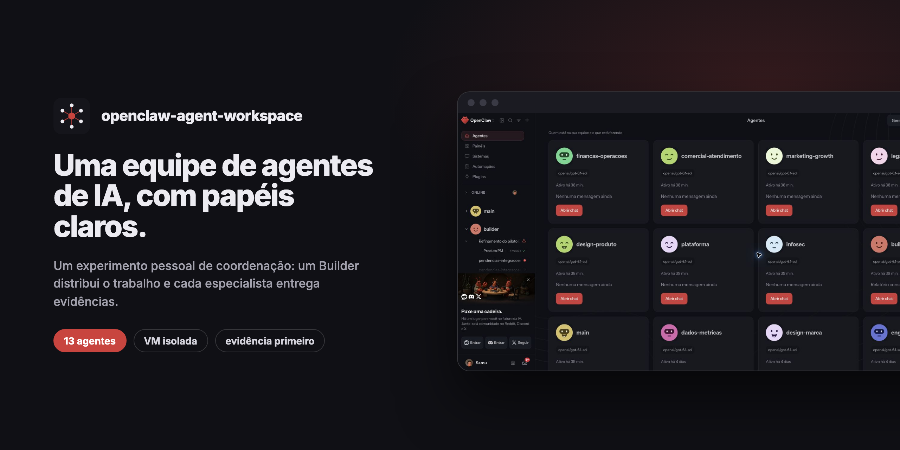
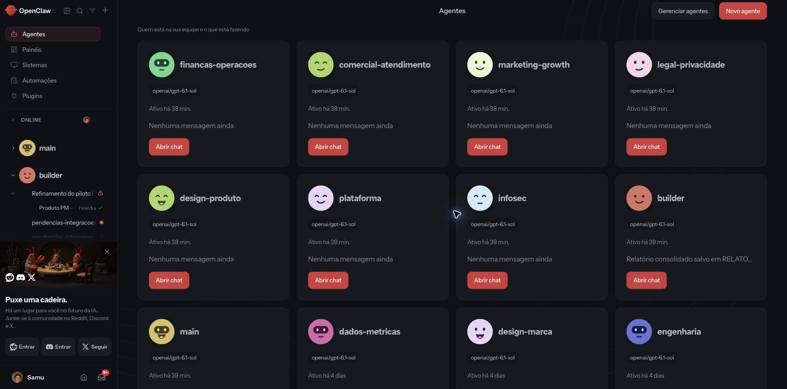
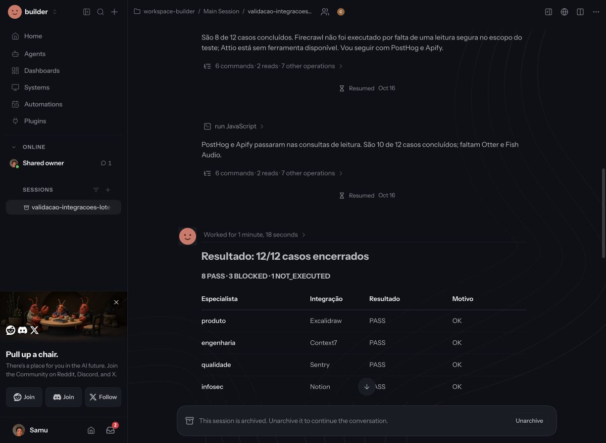
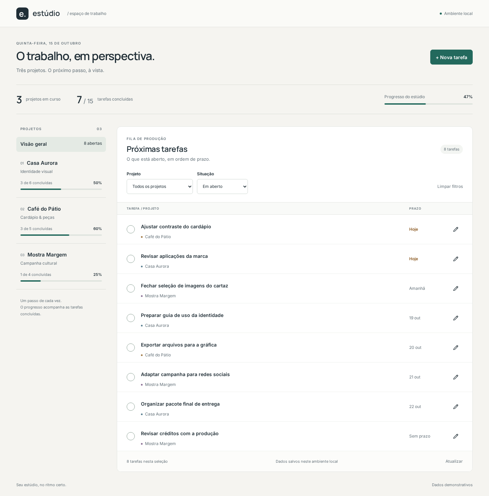
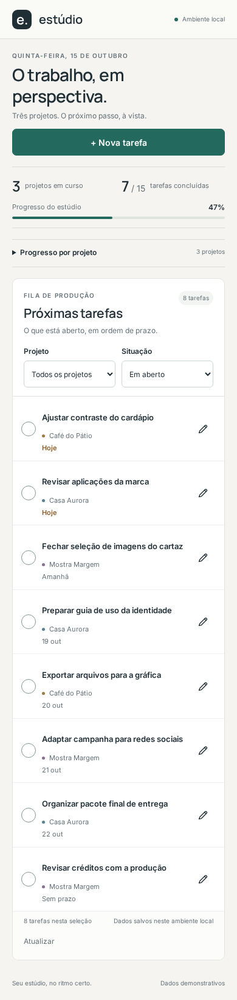
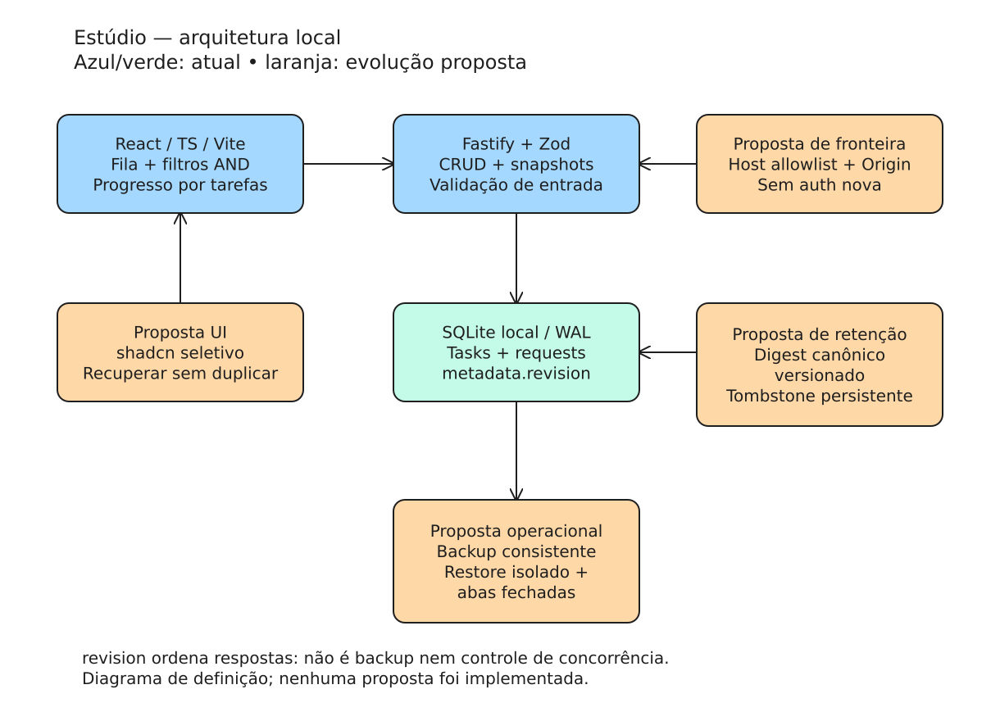
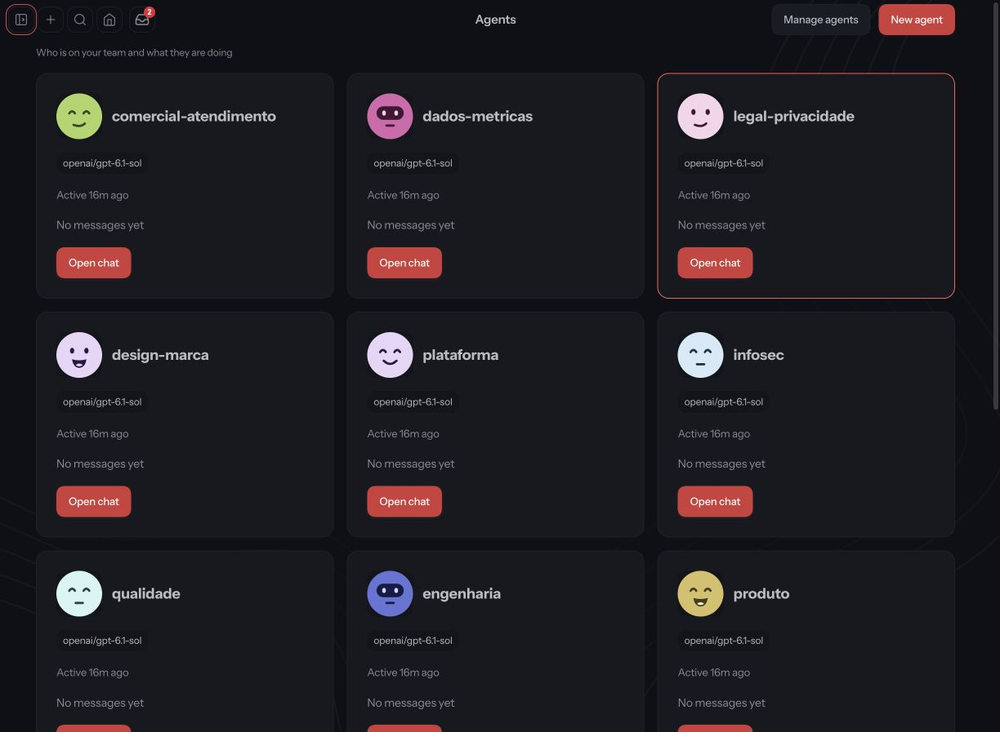

<p align="center">
  
</p>

<p align="center">
  <a href="#português">Português</a> · <a href="#english">English</a>
</p>

<p align="center">
  
  
  
  
</p>

---

## Português

Um experimento pessoal para coordenar uma **equipe de agentes de IA** em um ambiente local e isolado. Um agente **Builder** recebe pedidos abertos, transforma em perguntas, entregas e critérios verificáveis, e encaminha cada parte para um especialista. Produto, Design, Engenharia, Qualidade, Segurança, Plataforma, Dados, Marketing, Comercial, Finanças e Jurídico deixam contribuições separadas e conferíveis.

A regra do experimento é simples: **evidência primeiro**. Uma ferramenta que aparece no catálogo não é uma ferramenta que funcionou. Conexão, chamada e resultado validado são estados diferentes, e o Builder registra os bloqueios sem esconder falhas.

> Projeto de portfólio e documentação. Não é um produto pronto para instalar. Veja a seção [Estado e limites](#estado-e-limites).

### O OpenClaw em uso

A imagem abaixo foi capturada no OpenClaw em execução.

<p align="center">
  
</p>

**Um lote de validação coordenado pelo Builder.** O lote terminou com **8 casos aprovados, 3 bloqueados e 1 não executado**. Isso registra apenas os testes descritos e não certifica as integrações por completo. Os bloqueios ficaram visíveis de propósito.

<p align="center">
  
</p>

### O que este repositório mostra

- como dividir uma demanda entre agentes com papéis claros;
- como controlar ferramentas e permissões por agente;
- como registrar decisões, entregas, erros e bloqueios;
- como fazer um agente entregar contexto para o próximo;
- como manter o ambiente isolado em uma VM;
- como validar o resultado no GitHub e em artefatos locais.

### Como a coordenação funciona

1. O Builder recebe um pedido ainda incompleto.
2. Ele o transforma em perguntas, entregas e critérios verificáveis.
3. Cada especialista trabalha dentro do próprio escopo.
4. As entregas passam adiante como arquivos, links ou decisões registradas.
5. Qualidade revisa e separa evidência observada de proposta futura.
6. O Builder consolida o pacote e registra bloqueios, sem esconder falhas.

```text
pedido aberto
      |
    Builder
      |
  Produto ---- Design
      |           |
      +----- Engenharia
                    |
              Qualidade + Segurança
                    |
              pacote verificável
```

### A equipe

| Agente | Papel | Entrega principal |
|---|---|---|
| [`builder`](agents/builder/AGENTS.md) | Coordenação | estrutura a demanda e distribui o trabalho |
| [`produto`](agents/produto/AGENTS.md) | Produto | problema, público, jornadas e critérios |
| [`design-produto`](agents/design-produto/AGENTS.md) | Design de produto | fluxos e interface |
| [`design-marca`](agents/design-marca/AGENTS.md) | Marca | direção visual e linguagem |
| [`engenharia`](agents/engenharia/AGENTS.md) | Engenharia | arquitetura, código e integração |
| [`qualidade`](agents/qualidade/AGENTS.md) | Qualidade | revisão independente e evidências |
| [`infosec`](agents/infosec/AGENTS.md) | Segurança | riscos, limites e proteção de dados |
| [`plataforma`](agents/plataforma/AGENTS.md) | Plataforma | operação, ambiente e recuperação |
| [`dados-metricas`](agents/dados-metricas/AGENTS.md) | Dados | métricas e instrumentos de análise |
| [`marketing-growth`](agents/marketing-growth/AGENTS.md) | Marketing | posicionamento e experimentos |
| [`comercial-atendimento`](agents/comercial-atendimento/AGENTS.md) | Comercial | demonstração, onboarding e feedback |
| [`financas-operacoes`](agents/financas-operacoes/AGENTS.md) | Finanças | custos e viabilidade |
| [`legal-privacidade`](agents/legal-privacidade/AGENTS.md) | Jurídico | privacidade e limites de uso |

O `main` é o ponto de entrada do workspace, não uma especialidade. O mapa de papéis está em [`agents/roles.yaml`](agents/roles.yaml) e as regras comuns em [`agents/TEAM-CONTRACT.md`](agents/TEAM-CONTRACT.md).

### Um exemplo: o piloto Estúdio

O Estúdio foi a demanda usada para observar a equipe em ação: o Builder encaminhou a definição para Produto, a direção visual para Design e a arquitetura para Engenharia, com Qualidade e Segurança revisando. Ele serve só como exemplo do fluxo, e os dados das telas são demonstrativos.

<table>
  <tr>
    <td width="70%"></td>
    <td width="30%"></td>
  </tr>
</table>

O diagrama de arquitetura do piloto separa o que existe (azul e verde) do que era apenas **proposta** (laranja). Nenhuma proposta foi implementada, e o diagrama diz isso.

<p align="center">
  
</p>

### Segurança

O experimento rodou em uma **VM Ubuntu separada** do ambiente principal. O acesso ao gateway local passou por túnel SSH, e a interface exigiu autenticação do gateway. As permissões foram tratadas **por agente**, e ferramentas externas só deveriam ser usadas quando autorizadas, com atenção a autenticação, custo e dados acessados.

Este repositório **não contém** tokens, credenciais, arquivos de autenticação, bancos locais, logs privados, históricos completos de conversas nem a configuração da VM. Os arquivos de configuração são modelos sanitizados. Leia o [SECURITY.md](SECURITY.md) antes de adaptar qualquer exemplo.

### Como a IA entra, com honestidade

Aqui a IA é o próprio assunto: os agentes são modelos de linguagem configurados no OpenClaw. O que eu faço neste projeto é desenhar a equipe, definir papéis e regras, e revisar o que os agentes entregam. As instruções em [`agents/`](agents/README.md) foram derivadas das instruções reais dos meus workspaces, reduzidas e sanitizadas para publicação. A origem de cada uma está em [`agents/SOURCES.md`](agents/SOURCES.md).

### Estado e limites

- É um **experimento pessoal**, documentado como portfólio. Alguns fluxos são demonstrativos e algumas integrações dependem de autenticação ou serviços externos.
- Os perfis em `agents/` **não são a configuração operacional completa**, e sim uma edição pública deles.
- O resultado do lote de validação (8 aprovados, 3 bloqueados, 1 não executado) vale só para os testes descritos.
- Não há código para instalar. Para usar as ideias, adapte `agents/roles.yaml`, o contrato da equipe e os perfis à sua própria instalação, com os seus controles técnicos de permissão.

### Estrutura

```text
agents/      perfis de função sanitizados, contrato da equipe e proveniência
docs/        arquitetura, coordenação, segurança e capturas (docs/assets)
examples/    exemplo resumido do piloto Estúdio
```

<details>
<summary>Mais capturas, em inglês</summary>

<p>
  
  
</p>

</details>

---

## English

A personal experiment in coordinating a **team of AI agents** in a local, isolated environment. A **Builder** agent receives open-ended requests, turns them into questions, deliverables and verifiable criteria, and routes each part to a specialist. Product, Design, Engineering, Quality, Security, Platform, Data, Marketing, Sales, Finance and Legal each leave separate, checkable contributions.

The rule of the experiment is simple: **evidence first**. A tool listed in a catalog is not a tool that worked. Connection, call and validated result are different states, and the Builder records blockers without hiding failures.

> Portfolio and documentation project. Not a ready-to-install product. See [Status and limits](#status-and-limits).

### OpenClaw in use

The screenshots above were captured from OpenClaw running. A validation batch coordinated by the Builder ended with **8 cases passed, 3 blocked and 1 not executed**. That only records the tests described and does not certify the integrations as a whole. Blockers were left visible on purpose.

### What this repository shows

- how to split a request across agents with clear roles;
- how to control tools and permissions per agent;
- how to record decisions, deliverables, errors and blockers;
- how to have one agent hand context to the next;
- how to keep the environment isolated in a VM;
- how to validate results on GitHub and in local artifacts.

### How coordination works

1. The Builder receives a still-incomplete request.
2. It turns it into questions, deliverables and verifiable criteria.
3. Each specialist works within its own scope.
4. Deliverables are passed on as files, links or recorded decisions.
5. Quality reviews and separates observed evidence from future proposals.
6. The Builder consolidates the package and records blockers, without hiding failures.

The team table above lists the 13 agents. `main` is the workspace entry point, not a specialty. The role map is in [`agents/roles.yaml`](agents/roles.yaml) and the shared rules are in [`agents/TEAM-CONTRACT.md`](agents/TEAM-CONTRACT.md).

### Security

The experiment ran on a **separate Ubuntu VM**. Access to the local gateway went through an SSH tunnel and the interface required gateway authentication. Permissions were handled **per agent**, and external tools should only be used when authorized, with attention to authentication, cost and the data accessed.

This repository **does not contain** tokens, credentials, auth files, local databases, private logs, full conversation histories or the VM configuration. Config files are sanitized templates. Read [SECURITY.md](SECURITY.md) before adapting any example.

### How AI is used, honestly

Here AI is the subject itself: the agents are language models configured in OpenClaw. What I do in this project is design the team, define roles and rules, and review what the agents deliver. The instructions in [`agents/`](agents/README.md) were derived from the real instructions of my workspaces, reduced and sanitized for publication. The origin of each one is in [`agents/SOURCES.md`](agents/SOURCES.md).

### Status and limits

- It is a **personal experiment**, documented as a portfolio piece. Some flows are demonstrative and some integrations depend on authentication or external services.
- The profiles in `agents/` are **not the full operational configuration**, only a public edition of them.
- The validation batch result (8 passed, 3 blocked, 1 not executed) only applies to the tests described.
- There is no code to install. To use the ideas, adapt `agents/roles.yaml`, the team contract and the profiles to your own setup, with your own technical permission controls.

---

<p align="center">Feito por <a href="https://github.com/s1mh">Samuel Rocha</a>, estudante de Gestão de TI.</p>
