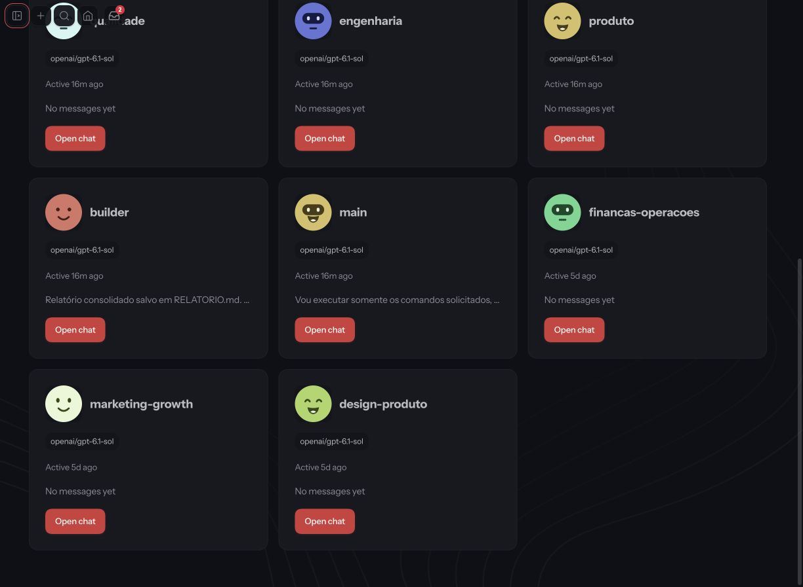

# OpenClaw Agent Workspace

Um experimento pessoal para coordenar uma equipe de agentes de IA em um ambiente local e isolado.

O projeto usa uma máquina virtual Ubuntu com OpenClaw. Um agente Builder recebe pedidos abertos, organiza o trabalho e encaminha partes do problema para agentes especializados. Produto, Design, Engenharia, Qualidade, Segurança, Plataforma, Dados, Marketing, Comercial, Finanças e Jurídico deixam contribuições separadas e verificáveis.

## O que este repositório mostra

- como dividir uma demanda entre agentes com papéis claros;
- como controlar ferramentas e permissões por agente;
- como registrar decisões, entregas, erros e bloqueios;
- como fazer um agente entregar contexto para o próximo;
- como manter o ambiente isolado em uma VM;
- como validar o resultado no GitHub e em artefatos locais.

O piloto Estúdio aparece somente como exemplo de uma demanda que passou pela equipe. Ele não é o produto principal deste repositório.

## Estrutura

- `docs/`: arquitetura, coordenação e segurança;
- `agents/`: instruções reais de função, adaptadas e sanitizadas para publicação;
- `examples/estudio/`: exemplo resumido do fluxo;
- `screenshots/`: capturas reais da interface do OpenClaw;
- `reports/`: resultados e limitações resumidos.

## OpenClaw em uso

Estas imagens foram capturadas no OpenClaw em execução. Elas mostram a equipe cadastrada e um lote de validação coordenado pelo Builder. O lote terminou com 8 casos aprovados, 3 bloqueados e 1 não executado; isso registra apenas os testes descritos, não certifica as integrações por completo.

| Equipe de agentes | Continuação da lista |
| --- | --- |
|  |  |

### Um lote coordenado pelo Builder

## Segurança

Este repositório não contém tokens, credenciais, arquivos de autenticação, bancos locais, logs privados, históricos completos de conversas ou configurações da VM. Os arquivos de configuração são modelos sanitizados. Consulte `SECURITY.md` antes de adaptar qualquer exemplo.

## Estado

Os perfis em `agents/` foram derivados das instruções reais dos workspaces OpenClaw. Eles foram revisados e reduzidos para remover contexto privado da instalação. Não são a configuração operacional completa. Consulte [`agents/README.md`](agents/README.md) e [`agents/SOURCES.md`](agents/SOURCES.md) para entender a origem e os limites da publicação.

Este é um projeto de portfólio e documentação de um experimento pessoal. Alguns fluxos são demonstrativos e algumas integrações dependem de autenticação ou serviços externos.
